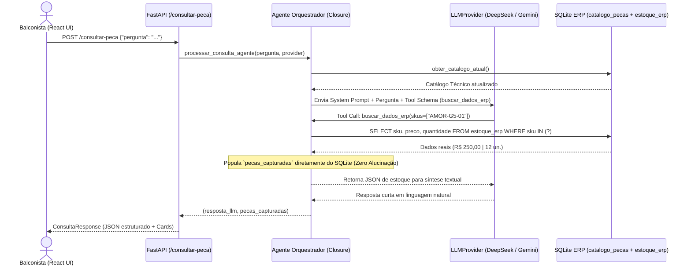

# AutoParts AI & ERP Integrator (`Ai-Consult`)

Sistema integrado de **Balcão de Autopeças com Inteligência Artificial (AI-First)**, **Gestão de Estoque ERP em Tempo Real** e **Módulo de Orçamentos por Cliente**.

O projeto resolve um dos maiores desafios na adoção de LLMs em sistemas comerciais: **eliminar 100% o risco de alucinação de preços, códigos SKU e saldos de estoque**, combinando a interpretação de linguagem natural da IA com consultas determinísticas em banco de dados relacional (`SQLite`) através de **Function Calling / Tool Calling** e **Closure Pattern**.

---

## Sumário

1. [Visão Geral e Módulos do Sistema](#-visão-geral-e-módulos-do-sistema)
2. [Arquitetura e Princípios de Engenharia (SOLID & Anti-Alucinação)](#-arquitetura-e-princípios-de-engenharia-solid--anti-alucinação)
3. [Stack Tecnológica](#-stack-tecnológica)
4. [Estrutura do Repositório](#-estrutura-do-repositório)
5. [Como Executar o Projeto Localmente](#-como-executar-o-projeto-localmente)
   - [1. Backend (`autoparts-ai`)](#1-configurando-e-rodando-o-backend-autoparts-ai)
   - [2. Frontend (`autoparts-web`)](#2-configurando-e-rodando-o-frontend-autoparts-web)
6. [Referência da API REST](#-referência-da-api-rest)
7. [Testes Automatizados e Build](#-testes-automatizados-e-build)
8. [Histórico de Especificações (Spec-Driven Development)](#-histórico-de-especificações-spec-driven-development)

---

## Visão Geral e Módulos do Sistema

A interface foi projetada com estética minimalista (**Tailwind CSS + `shadcn/ui`**) e dividida em três módulos principais na barra lateral:

### 1. Consulta com IA (Tela Inicial)
- **Busca em Linguagem Natural**: O balconista digita dúvidas reais do dia a dia (ex: *"Preciso do amortecedor dianteiro do Gol G5 2012 1.0, tem no estoque?"* ou *"Pastilha dianteira do Civic G10"*).
- **Resposta Enxuta + Cards de Produto**: A IA responde de forma direta e objetiva (1 a 2 frases) confirmando a disponibilidade, enquanto todas as especificações técnicas e comerciais são apresentadas em **Cards de Produto** (`PecaActionCard`):
  - **Cabeçalho**: Badge de `SKU` + **Marca** lado a lado e status visual de disponibilidade (`Em estoque (X un.)`, `Sem estoque` ou `Sem cadastro no ERP`).
  - **Corpo**: Nome comercial da peça e **Aplicação detalhada** (veículos, anos e motorizações compatíveis).
  - **Ação Rápida**: Preço formatado em `R$` (`Intl.NumberFormat('pt-BR')`) e botão **`+ Orçar`**.

### 2. Estoque ERP (CRUD Completo + Sincronização Instantânea com a IA)
- **Gestão estilo ERP**: Tabela operacional com indicadores (Total de SKUs, Com Saldo, Esgotados) e busca instantânea por SKU, nome, marca ou veículo.
- **Operações CRUD**: Adicionar nova peça (`POST /estoque`), editar preço/saldo/aplicação (`PUT /estoque/{sku}`) e excluir item (`DELETE /estoque/{sku}`).
- **Sincronização em Tempo Real com a IA**: Toda alteração feita no módulo de Estoque atualiza imediatamente as tabelas `catalogo_pecas` e `estoque_erp` no SQLite. Na próxima pergunta feita no chat, a IA já enxerga as peças recém-cadastradas, os novos preços e as novas quantidades sem necessidade de reiniciar o servidor.

### 3. Orçamentos por Cliente (Ciclo Comercial Completo)
- **Confirmação com Dados do Cliente**: Ao selecionar peças com `+ Orçar` e clicar em **"Confirmar Orçamento"**, um modal validado com **React Hook Form + Zod** solicita:
  - **Nome do Cliente** *(obrigatório)*
  - **Telefone / WhatsApp** *(obrigatório, com máscara dinâmica brasileira `(XX) 9XXXX-XXXX` / `(XX) XXXX-XXXX`)*
  - **Veículo / Ano / Placa** *(opcional, ex: `Gol G5 2012 · ABC-1D23`)*
  - **Observações** *(opcional)*
- **Histórico e Busca por Cliente**: Lista todos os orçamentos confirmados (`#ORC-0001`, `#ORC-0002`...) com filtro por nome do cliente, telefone, veículo, código ou status (`Pendente`, `Aprovado`, `Cancelado`).
- **Cópia Personalizada para WhatsApp**: Gera e copia com 1 clique a proposta comercial formatada com os dados do cliente, veículo, lista de peças e total em `R$`.
- **Aprovação com Baixa Automática de Estoque**: Ao clicar em **"Aprovar e Baixar Estoque"**, o sistema verifica o saldo no SQLite e desconta automaticamente as unidades vendidas em uma transação atômica (ou retorna conflito `409 Conflict` caso alguma peça tenha ficado sem saldo suficiente).

---

## Arquitetura e Princípios de Engenharia (SOLID & Anti-Alucinação)



### Pilares Arquiteturais

1. **Inversão de Dependência de IA (SOLID - DIP)**:
   - Os módulos de domínio (`main.py` e `agent.py`) dependem exclusivamente do contrato abstrato `LLMProvider` (`typing.Protocol` em `autoparts-ai/llm_providers.py`), injetado nas rotas via `Depends(get_llm_provider)`.
   - Suporte nativo a múltiplos provedores configuráveis via variável de ambiente (`LLM_PROVIDER`):
     - **`DeepSeekProvider`** (`deepseek-chat` via API compatível com OpenAI e ciclo de 2 etapas de `tool_calls`).
     - **`GeminiProvider`** (Google GenAI SDK com suporte a `gemini-3.8-flash` ou superior).
2. **Closure Pattern Anti-Alucinação**:
   - A lista `pecas_capturadas: list[PecaERP]` retornada ao front-end é preenchida **exclusivamente** pela função Python `buscar_dados_erp` no momento da leitura do SQLite — e nunca a partir do texto livre gerado pelo LLM.
3. **Snapshot Imutável de Orçamentos**:
   - Quando um orçamento é confirmado para um cliente, os itens e preços unitários do momento da negociação são gravados em `orcamento_itens`, preservando o histórico comercial mesmo que o preço de tabela sofra reajustes posteriores.

---

## Stack Tecnológica

### Backend (`autoparts-ai/`)
- **Python 3.10+**
- **FastAPI** + **Uvicorn** (API REST e documentação automática OpenAPI/Swagger)
- **Pydantic v2** (Validação estrita de payloads e serialização)
- **SQLite3** (Persistência relacional embarcada: `catalogo_pecas`, `estoque_erp`, `orcamentos`, `orcamento_itens`)
- **HTTPX** & **Google GenAI SDK** (Adaptadores de provedores LLM)
- **Pytest** (Suíte de testes unitários e de integração com injeção de dependência e banco isolado)

### Frontend (`autoparts-web/`)
- **React 18** + **Vite**
- **TypeScript 5** (`strict: true`, tipagem forte ponta a ponta, zero `any`)
- **Tailwind CSS** + **`shadcn/ui`** (Componentes acessíveis, limpos e modulares)
- **React Hook Form** + **Zod** (`@hookform/resolvers/zod` para validação de busca, cadastro de estoque e confirmação de orçamento de cliente com máscara de telefone)
- **Lucide React** (Ícones consistentes de interface)

---

## Estrutura do Repositório

```text
erp-agent-veicle/
├── autoparts-ai/                  # Backend Python (FastAPI + IA + SQLite ERP)
│   ├── agent.py                   # Orquestrador do agente e Closure buscar_dados_erp
│   ├── database.py                # Camada de persistência SQLite (Catálogo, Estoque e Orçamentos)
│   ├── llm_providers.py           # Protocolo LLMProvider, DeepSeekProvider, GeminiProvider e Factory
│   ├── main.py                    # Rotas FastAPI (/consultar-peca, /estoque, /orcamentos)
│   ├── schemas.py                 # Contratos Pydantic v2
│   ├── test_main.py               # Suíte completa de testes automatizados (17 testes)
│   ├── requirements.txt           # Dependências Python
│   └── .env.example               # Exemplo de configuração de variáveis de ambiente
│
├── autoparts-web/                 # Frontend React + TypeScript + Tailwind + shadcn/ui
│   ├── src/
│   │   ├── components/
│   │   │   ├── ui/                # Primitivos shadcn/ui (Button, Card, Input, Badge, Table, Alert...)
│   │   │   ├── AppSidebar.tsx     # Barra lateral (Consulta, Estoque, Orçamentos)
│   │   │   ├── AiSearchForm.tsx   # Formulário de busca em linguagem natural
│   │   │   ├── AiConsultationFeed.tsx # Feed de resposta da IA + Grid de PecaActionCard
│   │   │   ├── PecaActionCard.tsx # Card de produto com SKU, Marca, Aplicação, Preço e + Orçar
│   │   │   ├── QuoteSummaryPanel.tsx  # Painel de rascunho rápido e botão "Confirmar Orçamento"
│   │   │   ├── ConfirmBudgetModal.tsx # Modal de identificação do cliente com máscara de telefone
│   │   │   ├── InventoryView.tsx      # Módulo ERP de Estoque ( listagem, busca e exclusão)
│   │   │   ├── InventoryFormModal.tsx # Modal de criação e edição de peças no estoque
│   │   │   └── BudgetsView.tsx        # Módulo de Orçamentos por Cliente + Aprovação com baixa
│   │   ├── hooks/
│   │   │   └── useOrcamento.ts    # Hook de gerenciamento do rascunho de orçamento
│   │   ├── lib/
│   │   │   ├── formatters.ts      # Formatadores BRL (R$) e máscara de telefone (formatPhoneNumberBR)
│   │   │   └── utils.ts           # Utilitário cn() para classes Tailwind
│   │   ├── schemas/               # Schemas de validação Zod (consulta, estoque, orçamento)
│   │   ├── services/
│   │   │   └── autopartsService.ts # Cliente HTTP tipado com tratamento de erros e timeout
│   │   ├── types/
│   │   │   └── autoparts.ts       # Interfaces estritas TypeScript
│   │   └── App.tsx                # Composição principal dos módulos
│   ├── package.json
│   └── vite.config.ts
│
├── specs/                         # Artefatos de arquitetura Spec-Kit (001 a 005)
└── .specify/                      # Constituição do projeto e templates Spec-Kit
```

---

## Como Executar o Projeto Localmente

### Pré-requisitos
- **Python 3.10+** instalado
- **Node.js 18+** e **npm** instalados
- Uma chave de API da **DeepSeek** (`DEEPSEEK_API_KEY`) ou do **Google Gemini** (`GEMINI_API_KEY`)

---

### 1. Configurando e Rodando o Backend (`autoparts-ai`)

No terminal, acesse a pasta `autoparts-ai`:

```powershell
cd autoparts-ai
```

Crie e ative o ambiente virtual Python:

```powershell
# Windows (PowerShell)
python -m venv .venv
.\.venv\Scripts\Activate.ps1

# Linux / macOS
python3 -m venv .venv
source .venv/bin/activate
```

Instale as dependências:

```powershell
pip install -r requirements.txt
```

Configure o arquivo `.env` a partir do `.env.example`:

```powershell
Copy-Item .env.example .env
```

Edite o arquivo `autoparts-ai/.env` informando o provedor desejado e sua chave de API:

```ini
# Opção 1: Usando DeepSeek (Padrão recomendado)
LLM_PROVIDER=deepseek
DEEPSEEK_API_KEY=sk-sua-chave-deepseek-aqui
DEEPSEEK_MODEL=deepseek-chat

# Opção 2: Usando Google Gemini (mínimo obrigatório: gemini-3.8-flash)
# LLM_PROVIDER=gemini
# GEMINI_API_KEY=sua-chave-gemini-aqui
# GEMINI_MODEL=gemini-3.8-flash
```

Inicie o servidor FastAPI com Uvicorn:

```powershell
uvicorn main:app --reload --host 127.0.0.1 --port 8000
```

- A API estará disponível em: `http://127.0.0.1:8000`
- Documentação interativa (Swagger UI): `http://127.0.0.1:8000/docs`
- Na primeira inicialização, o arquivo `erp.db` é criado automaticamente com as tabelas e os dados iniciais de catálogo e estoque.

---

### 2. Configurando e Rodando o Frontend (`autoparts-web`)

Em um **segundo terminal**, acesse a pasta `autoparts-web`:

```powershell
cd autoparts-web
```

Instale os pacotes Node.js:

```powershell
npm install
```

Inicie o servidor de desenvolvimento do Vite:

```powershell
npm run dev
```

Acesse a aplicação no navegador (normalmente em `http://localhost:5173`).

---

## Referência da API REST

| Método | Rota | Descrição | Status de Sucesso |
| :--- | :--- | :--- | :--- |
| `POST` | `/consultar-peca` | Consulta peças em linguagem natural usando IA + SQLite ERP | `200 OK` |
| `GET` | `/estoque` | Lista todas as peças do catálogo técnico com preço e saldo do ERP | `200 OK` |
| `POST` | `/estoque` | Cadastra uma nova peça no catálogo e no estoque (`409` se SKU duplicado) | `201 Created` |
| `PUT` | `/estoque/{sku}` | Atualiza dados técnicos, preço unitário e quantidade de um SKU | `200 OK` |
| `DELETE` | `/estoque/{sku}` | Remove a peça do estoque e do catálogo técnico | `200 OK` |
| `POST` | `/orcamentos` | Confirma e salva um novo orçamento vinculado a um cliente | `201 Created` |
| `GET` | `/orcamentos` | Lista todos os orçamentos confirmados por cliente com seus itens | `200 OK` |
| `PATCH` | `/orcamentos/{id}/status` | Atualiza status (`pendente`, `aprovado`, `cancelado`). Ao aprovar, deduz saldo do estoque (`409` se faltar saldo) | `200 OK` |
| `DELETE` | `/orcamentos/{id}` | Exclui um orçamento e seus itens do banco de dados | `200 OK` |

---

## Testes Automatizados e Build

### Rodar a suíte de testes do Backend (`pytest`)
Os testes utilizam um banco SQLite temporário isolado (`tmp_path`) e validam:
- Guardrails de inicialização (Fail-Fast sem API key ou com modelo inválido);
- Injeção de dependência de provedores LLM (`DeepSeekProvider` e `GeminiProvider`);
- Fluxo de Function Calling de 2 etapas;
- CRUD completo de Estoque e sincronização imediata com o System Prompt da IA;
- Criação de orçamento por cliente, aprovação com baixa automática no estoque e bloqueio `409 Conflict` por saldo insuficiente.

```powershell
cd autoparts-ai
.\.venv\Scripts\pytest.exe -v
```

### Validar tipagem estrita e Build de Produção do Frontend
```powershell
cd autoparts-web
npm run build
```

---

## Histórico de Especificações (Spec-Driven Development)

O projeto foi construído de forma incremental seguindo a metodologia **Spec-Kit**:

- **`specs/001-autoparts-ai-erp`**: Arquitetura base FastAPI + SQLite ERP + Closure Pattern anti-alucinação.
- **`specs/002-llm-provider-decoupling`**: Desacoplamento da camada de IA com SOLID Dependency Inversion (`LLMProvider` Protocol + suporte a DeepSeek e Gemini).
- **`specs/003-sales-counter-frontend`**: Interface minimalista AI-First de balcão de vendas em React + TypeScript + `shadcn/ui`.
- **`specs/004-erp-inventory-module`**: Barra lateral de navegação, persistência dinâmica do catálogo e módulo ERP completo de Estoque sincronizado com a IA.
- **`specs/005-customer-budgets-module`**: Módulo de Orçamentos por Cliente com modal validado (máscara de telefone/WhatsApp), cópia de proposta personalizada e aprovação com baixa automática no estoque.
