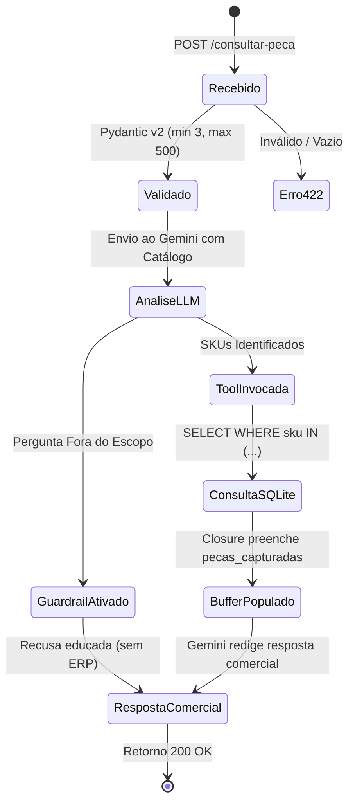

# Data Model: AutoParts AI & ERP Integrator

## Entidades do Sistema

### 1. `ItemCatalogoTecnico` (Catálogo em Memória / RAG)
Representa as informações de engenharia e aplicação veicular de uma autopeça. No MVP é mantido em memória e injetado no System Prompt; na Fase 2 será migrado para ChromaDB.

| Campo | Tipo | Descrição | Exemplo |
|---|---|---|---|
| `sku` | `str` (Chave Primária Lógica) | Código identificador único da peça | `"AMOR-G5-01"` |
| `nome_peca` | `str` | Descrição comercial da peça | `"Amortecedor Dianteiro Turbogas"` |
| `marca` | `str` | Fabricante da autopeça | `"Cofap"` |
| `aplicacao` | `str` | Veículos, anos e motores compatíveis | `"Volkswagen Gol G5 2009 a 2012 (1.0 / 1.6)"` |

---

### 2. `EstoqueERP` (Tabela Relacional SQLite)
Tabela `estoque_erp` persistida no banco SQLite `erp.db`. Contém estritamente os dados operacionais e financeiros.

```sql
CREATE TABLE IF NOT EXISTS estoque_erp (
    sku TEXT PRIMARY KEY,
    preco REAL NOT NULL,
    quantidade INT NOT NULL
);
```

| Coluna | Tipo SQLite | Restrições | Descrição |
|---|---|---|---|
| `sku` | `TEXT` | `PRIMARY KEY` | Identificador único correspondente ao catálogo |
| `preco` | `REAL` | `NOT NULL` | Valor unitário de venda em reais |
| `quantidade` | `INTEGER` | `NOT NULL` | Saldo físico disponível em estoque (≥ 0) |

#### Dados de Semente (Seed Data):
| SKU | Preço (R$) | Quantidade | Cenário Coberto |
|---|---|---|---|
| `AMOR-G5-01` | 250.00 | 12 | Peça com estoque disponível |
| `AMOR-G5-02` | 180.00 | 0 | Peça cadastrada com estoque zerado |
| `PAST-CIV-10` | 145.90 | 8 | Peça com estoque disponível |
| `FILT-COR-15` | 38.50 | 0 | Peça cadastrada com estoque zerado |
| `VELA-UNO-11` | *Ausente* | *Ausente* | Peça existente no catálogo, mas sem cadastro no ERP |

---

### 3. `ConsultaRequest` (Payload de Entrada)
Modelo Pydantic v2 para validação e sanitização da requisição.

| Campo | Tipo | Validações | Descrição |
|---|---|---|---|
| `pergunta` | `str` | `min_length=3`, `max_length=500`, trim de whitespace | Pergunta em linguagem natural sobre compatibilidade/peças |

---

### 4. `PecaERP` (Metadado de Retorno da Peça)
Modelo Pydantic v2 representando uma peça identificada na consulta e enriquecida com dados do ERP.

| Campo | Tipo | Obrigatório | Descrição |
|---|---|---|---|
| `sku` | `str` | Sim | Código SKU da peça |
| `nome_peca` | `str` | Sim | Nome da peça vindo do catálogo |
| `em_estoque` | `bool` | Sim | `True` se `quantidade > 0`; caso contrário `False` |
| `preco` | `float | None` | Não | Preço unitário (nulo se não cadastrado no ERP) |
| `quantidade` | `int | None` | Não | Saldo em estoque (nulo se não cadastrado no ERP) |

---

### 5. `ConsultaResponse` (Payload de Saída)
Modelo Pydantic v2 consolidado retornado pelo endpoint.

| Campo | Tipo | Descrição |
|---|---|---|
| `status` | `str` | `"sucesso"` ou status de operação |
| `pecas_encontradas` | `list[PecaERP]` | Lista das peças identificadas com dados auditados do ERP |
| `resposta` | `str` | Síntese comercial amigável redigida pelo agente Gemini |

---

## Ciclo de Vida e Transições de Estado


