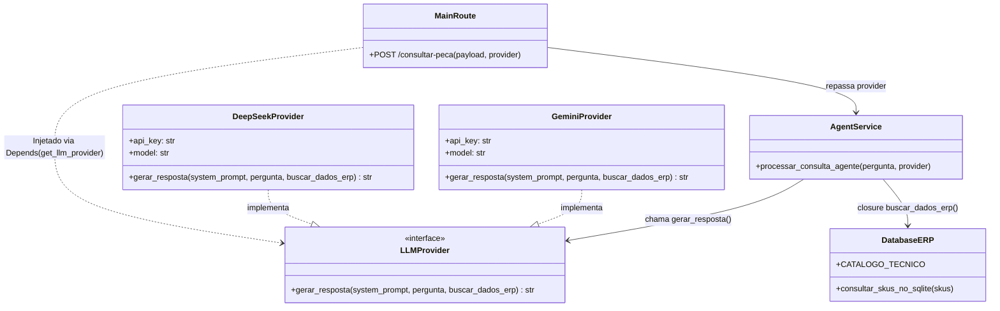
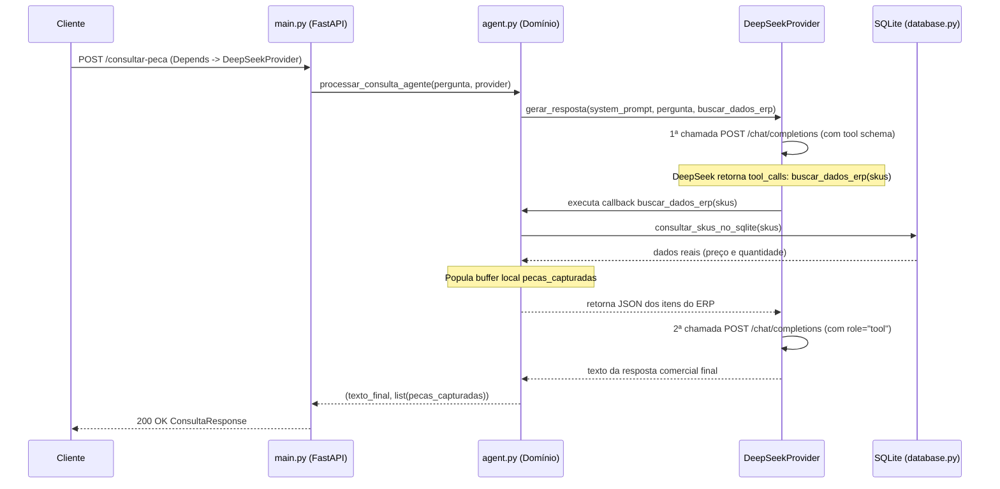

# Data Model & Architecture Entities: Desacoplamento de Provedor de IA

## 1. Contratos de Abstração e Injeção (`llm_providers.py`)

### `ToolCallback` (Type Alias)
Assinatura padronizada da closure de consulta ao ERP injetada no provedor de IA:
```python
ToolCallback = Callable[[list[str]], list[dict]]
```

---

### `LLMProvider` (`Protocol` / Interface Abstrata)
Contrato que todo motor de IA (DeepSeek, Gemini, OpenAI, Mock) deve implementar para ser injetado na aplicação.

| Método | Parâmetros | Retorno | Descrição |
|---|---|---|---|
| `gerar_resposta` | `system_prompt: str`, `pergunta: str`, `buscar_dados_erp: ToolCallback` | `str` | Executa o raciocínio do modelo, aciona `buscar_dados_erp(skus)` quando necessário e retorna a resposta comercial final. |

---

### `DeepSeekProvider` (Implementação Concreta)
Adaptador para a API da DeepSeek (`/chat/completions`).

| Atributo | Tipo | Padrão | Descrição |
|---|---|---|---|
| `api_key` | `str` | `os.getenv("DEEPSEEK_API_KEY")` | Chave de autenticação Bearer da DeepSeek |
| `model` | `str` | `"deepseek-chat"` | Modelo utilizado (`DEEPSEEK_MODEL`) |
| `base_url` | `str` | `"https://api.deepseek.com"` | Endpoint base da API (`DEEPSEEK_BASE_URL`) |
| `timeout` | `float` | `15.0` | Timeout rígido em segundos |

---

### `GeminiProvider` (Implementação Concreta)
Adaptador para o Google GenAI SDK.

| Atributo | Tipo | Padrão | Descrição |
|---|---|---|---|
| `api_key` | `str` | `os.getenv("GEMINI_API_KEY")` | Chave de API do Google AI Studio |
| `model` | `str` | `"gemini-3.8-flash"` | Modelo mínimo exigido pela Constituição (`GEMINI_MODEL`) |
| `timeout_ms` | `int` | `15000` | Timeout rígido em milissegundos (15s) |

---

### Exceções de Domínio Agnósticas

| Classe | Herança | Código HTTP em `main.py` | Quando é lançada |
|---|---|---|---|
| `LLMTimeoutError` | `Exception` | `504 Gateway Timeout` | Quando o provedor ativo (`deepseek` ou `gemini`) excede 15s |
| `LLMProviderError` | `Exception` | `502 Bad Gateway` | Quando o provedor ativo retorna erro de API (401, 402, 429, 500, 503) |

---

## 2. Diagrama de Arquitetura (Injeção de Dependência + Closure Pattern)



---

## 3. Fluxo de Execução do Tool Calling na DeepSeek


