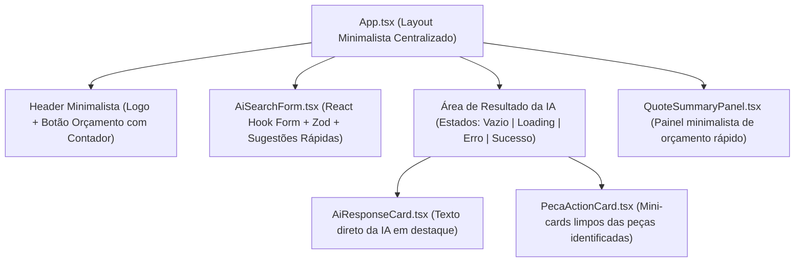

# Data Model & TypeScript Contracts: Minimalist AI Sales Counter

## 1. Tipos de Domínio e API (`src/types/autoparts.ts`)

```typescript
export interface ConsultaRequest {
  pergunta: string;
}

export interface PecaERP {
  sku: string;
  nome_peca: string;
  em_estoque: boolean;
  preco: number | null;
  quantidade: number | null;
}

export interface ConsultaResponse {
  status: string;
  pecas_encontradas: PecaERP[];
  resposta: string;
}

export interface InteracaoConsulta {
  id: string;
  pergunta: string;
  resposta: string;
  pecas_encontradas: PecaERP[];
  criadoEm: string;
}

export interface ItemOrcamento {
  sku: string;
  nome_peca: string;
  preco: number;
  quantidadeSelecionada: number;
  estoqueMaximo: number;
}

export interface ApiError {
  status: number;
  title: string;
  detail: string;
  canRetry: boolean;
}
```

---

## 2. Schema de Validação Zod (`src/schemas/consultaSchema.ts`)

```typescript
import { z } from "zod";

export const consultaSchema = z.object({
  pergunta: z
    .string()
    .trim()
    .min(3, "Digite pelo menos 3 caracteres para consultar a IA.")
    .max(500, "A pergunta deve ter no máximo 500 caracteres."),
});

export type ConsultaFormValues = z.infer<typeof consultaSchema>;
```

---

## 3. Hierarquia Minimalista de Componentes React


