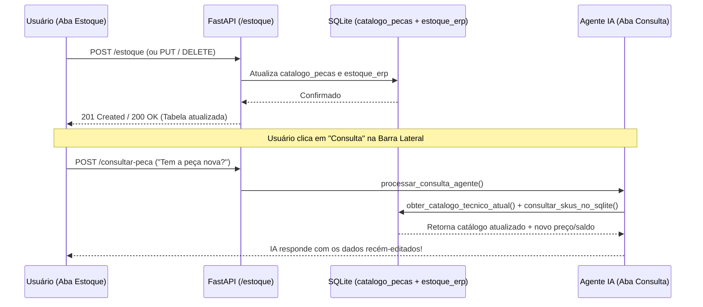

# Data Model: Módulo de Estoque ERP Sincronizado com IA

## 1. Modelo Relacional SQLite (`autoparts-ai/database.py`)

### Tabela `catalogo_pecas` (Catálogo Técnico Dinâmico)
```sql
CREATE TABLE IF NOT EXISTS catalogo_pecas (
    sku TEXT PRIMARY KEY,
    nome_peca TEXT NOT NULL,
    marca TEXT NOT NULL,
    aplicacao TEXT NOT NULL
);
```

### Tabela `estoque_erp` (Dados Operacionais do ERP)
```sql
CREATE TABLE IF NOT EXISTS estoque_erp (
    sku TEXT PRIMARY KEY,
    preco REAL NOT NULL,
    quantidade INT NOT NULL
);
```

### Consulta Consolidada (`LEFT JOIN`) para a Tabela de Estoque
```sql
SELECT
    c.sku,
    c.nome_peca,
    c.marca,
    c.aplicacao,
    e.preco,
    e.quantidade
FROM catalogo_pecas c
LEFT JOIN estoque_erp e ON c.sku = e.sku
ORDER BY c.sku ASC;
```

---

## 2. Schemas Pydantic v2 (`autoparts-ai/schemas.py`)

```python
class EstoqueItemResponse(BaseModel):
    sku: str
    nome_peca: str
    marca: str
    aplicacao: str
    preco: float | None = None
    quantidade: int | None = None
    em_estoque: bool


class EstoqueCreateRequest(BaseModel):
    model_config = ConfigDict(str_strip_whitespace=True)

    sku: str = Field(..., min_length=2, max_length=40)
    nome_peca: str = Field(..., min_length=3, max_length=150)
    marca: str = Field(..., min_length=2, max_length=80)
    aplicacao: str = Field(..., min_length=3, max_length=250)
    preco: float = Field(..., ge=0.0)
    quantidade: int = Field(..., ge=0)


class EstoqueUpdateRequest(BaseModel):
    model_config = ConfigDict(str_strip_whitespace=True)

    nome_peca: str = Field(..., min_length=3, max_length=150)
    marca: str = Field(..., min_length=2, max_length=80)
    aplicacao: str = Field(..., min_length=3, max_length=250)
    preco: float = Field(..., ge=0.0)
    quantidade: int = Field(..., ge=0)
```

---

## 3. Tipos TypeScript & Schema Zod (`autoparts-web/src/`)

```typescript
export type ModuloAtivo = "consulta" | "estoque" | "orcamentos";

export interface EstoqueItem {
  sku: string;
  nome_peca: string;
  marca: string;
  aplicacao: string;
  preco: number | null;
  quantidade: number | null;
  em_estoque: boolean;
}

export interface EstoqueCreateInput {
  sku: string;
  nome_peca: string;
  marca: string;
  aplicacao: string;
  preco: number;
  quantidade: number;
}

export type EstoqueUpdateInput = Omit<EstoqueCreateInput, "sku">;
```

---

## 4. Fluxo de Sincronização Estoque <-> IA


